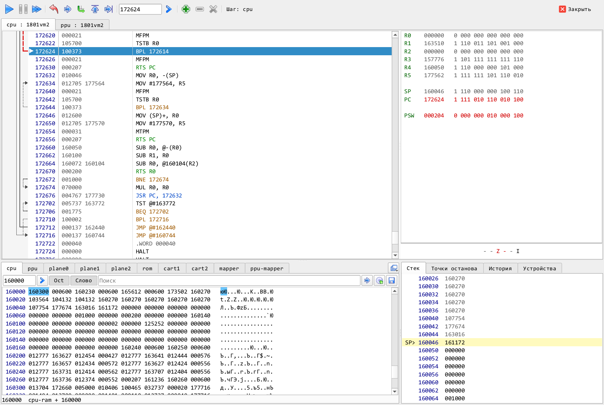

# Отладчик

Средства отладки программ в окне эмулятора: основной отладчик, дампы памяти, точки останова и шаги. Об остальном интерфейсе &ndash; в [руководстве пользователя](MANUAL.md), об отладке из сценариев &ndash; в [SCRIPTING.md](SCRIPTING.md) и [MCP.md](MCP.md).

* [Окно отладчика](#окно-отладчика)
* [Как отладчик управляет машиной](#как-отладчик-управляет-машиной)
* [Панель инструментов](#панель-инструментов)
* [Листинг](#листинг)
* [Регистры и флаги](#регистры-и-флаги)
* [Дампы памяти](#дампы-памяти)
* [Стек, точки останова, история, устройства](#стек-точки-останова-история-устройства)
* [Отладка из сценариев](#отладка-из-сценариев)
* [Числа](#числа)

 
<small>Отладчик УК-НЦ на паузе после двух шагов центрального процессора</small>

## Окно отладчика

Отладчик &ndash; одно окно на всю машину. Его можно открыть тремя способами:

1. Кнопкой  на панели главного окна.
2. Пунктом меню __&laquo;Отладка/Отладчик&raquo;__.
3. Через меню &laquo;Отладка/Устройства&raquo;, выбрав процессор. Если отладчик уже открыт, он выходит на передний план с вкладкой этого процессора.

Открытие окна машину не останавливает. Окно делится на две части:

* вверху &ndash; по вкладке на каждый процессор машины (у УК-НЦ, например, их две: ЦП и ПП). На вкладке листинг дизассемблера, справа от него регистры и флаги;
* внизу &ndash; дампы памяти и вкладки __&laquo;Стек&raquo;__, __&laquo;Точки останова&raquo;__, __&laquo;История&raquo;__, __&laquo;Устройства&raquo;__. Стек, точки останова и история относятся к процессору, чья вкладка открыта.

Размеры частей окна запоминаются между запусками.

## Как отладчик управляет машиной

Отладчик останавливает и запускает __всю машину__, а не отдельный процессор. На паузе стоят все процессоры и все устройства: таймеры, экран, звук, магнитофон.

Шаг тоже делается во времени. Выбранный процессор выполняет одну команду, остальные процессоры и устройства проходят тот же отрезок времени, в том же порядке, что и при обычной работе. Поэтому на двухпроцессорной машине шаг одного процессора не нарушает его обмен с другим. Шаг по команде __WAIT__ (__HLT__) длится до прерывания. Если за секунду времени машины процессор не выполнил ни одной команды (держится сбросом, ждет прерывания при запрещенных прерываниях), шаг прекращается с сообщением &laquo;не выполняет команд&raquo;.

Пока окно отладчика открыто, точка останова любого процессора ставит на паузу всю машину, как только остальные процессоры доходят до того же момента времени. Точка останова срабатывает перед выполнением команды по своему адресу. Если адрес стоит сразу за командой __WAIT__ или __HLT__, остановка будет после прерывания, когда программа действительно до него дойдет. Точки останова задаются по адресам так, как их видит процессор: у БК0011М &ndash; с учетом подключенных страниц, у ДВК-4 (ВМ3) &ndash; виртуальные адреса.

Кнопка останова главного окна при открытом отладчике работает как его пауза. При закрытии окна машина, стоявшая на паузе, продолжает работу; точки останова сохраняются, но больше не срабатывают, пока окно не будет открыто снова.

## Панель инструментов

* Управление машиной:
    *  &ndash; пуск с остановкой на точках останова, клавиша F9;
    *  &ndash; пауза, клавиша F12;
    *  &ndash; запуск без отладки: точки останова не срабатывают, пока машину не запустят кнопкой F9 или не поставят новую точку.
* Шаги процессора, чья вкладка открыта (доступны, когда машина на паузе):
    *  &ndash; показать в листинге текущую команду (PC), клавиша `*`;
    *  &ndash; шаг с заходом в подпрограмму, клавиша F7;
    *  &ndash; шаг через вызов, клавиша F8. Вызов подпрограммы (CALL, JSR, EMT, TRAP, INT и т.п.) выполняется целиком, машина останавливается после возврата из него. Повторяемая команда (`rep` у 8086, `LDIR` и подобные у Z80) выполняется до конца. Любая другая команда выполняется как обычный шаг;
    *  &ndash; выполнить до возврата из текущей подпрограммы, клавиши Ctrl+F8;
    *  &ndash; выполнить до команды под курсором листинга, клавиша F4.
* Переход по листингу: строка ввода адреса (она показывает адрес под курсором) и кнопка  (или Enter в строке).
* Точки останова:
    *  &ndash; поставить точку на команду под курсором;
    *  &ndash; снять точку под курсором;
    *  &ndash; снять все точки останова процессора (с подтверждением);
    * клавиша F2 ставит или снимает точку под курсором.
* Состояние машины: &laquo;Работает&raquo;, &laquo;Пауза&raquo;, &laquo;Шаг...&raquo; (долгий шаг еще идет), &laquo;Шаг&raquo;, &laquo;Точка останова&raquo;, &laquo;Остановлен&raquo; (после шага через вызов, выхода из подпрограммы или выполнения до курсора) с именем процессора, &laquo;Остановлен ошибкой устройства&raquo;.

Значения, изменившиеся с момента последнего запуска или шага, выделяются красным &ndash; в регистрах, флагах, стеке и дампах.

## Листинг

Строки листинга: метки точки останова и текущей команды, адрес, коды команды и сама команда. Слева стрелками показаны переходы, попадающие в видимую часть листинга (условные &ndash; пунктиром).

* Курсор двигают стрелки, PgUp/PgDn и колесо мыши; Home возвращает к текущей команде.
* Щелчок слева от адреса или двойной щелчок по адресу ставит или снимает точку останова.
* Двойной щелчок по команде перехода или вызова, а также Enter на ней, переходит к ее адресу назначения.
* Двойной щелчок по кодам команды открывает их редактирование: байты в шестнадцатеричной системе, на машинах с `radix = 8` &ndash; восьмеричные слова. Enter записывает, Esc отменяет. Запись идет и в ПЗУ.

Листинг дизассемблируется и назад от текущего места; если байты допускают два прочтения, предпочтение отдается адресам, по которым процессор уже выполнял команды. Адреса у 8086 показываются в виде `CS:IP`, когда они лежат в текущем сегменте кода.

## Регистры и флаги

Регистры показываются в системе счисления машины и в двоичном виде. Двойной щелчок по значению (или по двоичному представлению) открывает его редактирование, Enter записывает. Двойной щелчок по флагу переключает его. Изменения регистров и флагов попадают в запись действий как команды `setreg`.

## Дампы памяти

Вкладки дампов: адресное пространство каждого процессора (как его видит сам процессор, с учетом диспетчера памяти), затем диспетчеры памяти и все ОЗУ и ПЗУ машины. Дамп любого другого устройства добавляет кнопка  &laquo;Другое устройство&raquo; справа от вкладок. Эти же вкладки без остальных частей отладчика открывает пункт __&laquo;Отладка/Дампы&raquo;__.

Под дампом процессора (кроме ВМ3) и диспетчера памяти видно, какое устройство отвечает по адресу под курсором и по какому адресу внутри него.

Панель дампа:

* строка адреса и кнопка перехода;
* кнопки системы счисления (восьмеричная/шестнадцатеричная) и размера ячейки (байты/слова);
* поиск: значения в системе счисления дампа через пробел, или текст в кавычках &ndash; `"HELLO"`, в кодировке машины; кнопка &laquo;Найти далее&raquo;;
* загрузка файла в память с адреса курсора и сохранение всего дампа в файл.

Курсор двигают стрелки и PgUp/PgDn, Tab переключает его между числами и символами. Двойной щелчок или Enter открывает редактирование ячейки. Запись идет в память (и в ПЗУ), а там, где ПЗУ перекрывает ОЗУ, &ndash; и в ОЗУ под ним, как при записи программой. Регистры устройств в дампе только показываются: запись в них из дампа не делается, потому что устройство отреагировало бы на нее, как на запись процессора (передало бы байт, запустило бы канал). Регистр устройства можно изменить командой `COMMAND устройство.set(...)` (см. [SCRIPTING.md](SCRIPTING.md)).

## Стек, точки останова, история, устройства

* __&laquo;Стек&raquo;__ показывает ячейки вокруг указателя стека. Двойной щелчок или пункт &laquo;Перейти&raquo; контекстного меню показывает в листинге адрес, лежащий в ячейке (например, адрес возврата).
* __&laquo;Точки останова&raquo;__ &ndash; список точек процессора с командами. Двойной щелчок переходит к точке, Delete и пункт &laquo;Удалить&raquo; контекстного меню ее снимают. У процессора может быть до 256 точек останова.
* __&laquo;История&raquo;__ &ndash; адреса последних выполненных команд (256), от старых к новым: откуда программа пришла туда, где остановилась. Ее ведут процессоры К1801ВМ1/ВМ2/ВМ3 и 8086. Двойной щелчок переходит к адресу, контекстное меню ставит или снимает на нем точку останова.
* __&laquo;Устройства&raquo;__ &ndash; поля всех устройств машины (те же, что выводит `LOG` в сценариях). Пока машина работает, они обновляются раз в секунду; пункт &laquo;Обновить&raquo; контекстного меню обновляет сразу.

## Отладка из сценариев

Те же действия доступны сценариям и через MCP: `COMMAND cpu.pause()`, `cpu.go()`, `cpu.tstep(n)`, `cpu.over()`, `cpu.out()`, `cpu.until(адрес)`, а для просмотра &ndash; `LOG cpu.registers`, `LOG cpu.disasm(от, до)`, `LOG cpu.history(n)`. Подробнее &ndash; в [SCRIPTING.md](SCRIPTING.md).

## Числа

Числа в отладчике и в остальных отладочных окнах выводятся и вводятся в шестнадцатеричной системе, а для машин, описанных в восьмеричной (`radix = 8`: БК, ДВК, УК-НЦ), &ndash; в восьмеричной; в этом случае коды команд в дизассемблере и дамп показываются 16-разрядными словами. Число с префиксом (`$` &ndash; шестнадцатеричное, `&` &ndash; восьмеричное, `_` &ndash; десятичное) читается в своей системе независимо от машины.

Примечание: для того, чтобы иметь возможность настроить отладчик и другие окна до запуска эмулируемой машины, можно использовать параметр процессора stopped=1 в конфигурации машины (подробнее см. в [документации по настройке](CONFIG.md)).
